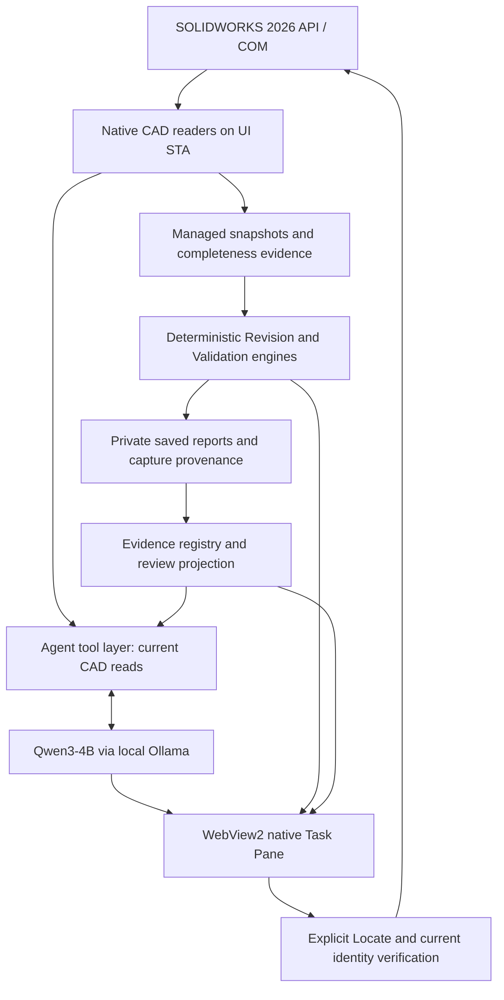

# Architecture overview

Phase 6B.1, 2026-10-25. Describes existing implementation; no runtime features were added.

## Ownership, lifecycle and threading

`SwAddin` is the COM-visible `ISwAddin` entry point. AutoDispatch supports the `IDispatch` callback parameter of `SetAddinCallbackInfo2`; the installed `ISwAddin` contract and existing identity remain intact. A WinForms WebView2 host is attached to a native Task Pane through the x64 HWND API.

`SolidWorksReader`, `SolidWorksRevisionReader`, document/selection notifications and native navigation run on the owning SOLIDWORKS UI STA. Thread guards reject worker-thread CAD reads. Agent requests marshal reads through a UI dispatcher; HTTP, managed processing and disk work can run asynchronously. Sessions invalidate stale contexts and cancel pending work during document changes/disposal. Unload unsubscribes events and disposes browser/control/session resources. Managed lifecycle tests do not certify every native unload scenario.

## Identity and bounded evidence

`RevisionSnapshotBuilder` produces managed DTOs. Scan-local occurrence IDs identify source evidence within a capture, not cross-capture identity. `ComponentIdentityResolver` reconciles same-assembly lineage using unique native persistent references or qualified hierarchy/reference/configuration evidence. Known SOLIDWORKS temporary-reference locations are normalized for qualified reconciliation; original observations remain available. Names, traversal positions and temporary paths alone do not justify ambiguous pairing.

The revision reader excludes the virtual root, uses `GetRootComponent3(false)` and avoids automatic reference resolution. Cached custom-property reads retain scope, availability, resolution and completeness. Revision traversal is bounded at 100 occurrences/depth 4, with 12 properties per scope/512 characters. Agent hierarchy defaults are 20/depth 2 within configurable maxima of 100/4. Missing model documents/properties do not erase independently known suppression evidence.

The comparer separates physical occurrence/quantity changes from suppression and technical reference observations. Unvisited components are not confirmed removals. Ambiguous or unavailable evidence withholds conclusions. The historical suppression-capture discrepancy remains unresolved: a saved transition does not prove the native UI state at the original capture.

## Deterministic observations and independent requirements

`RevisionComparer` compares captures. `DesignValidator` checks an independently loaded BOM/rule set rather than treating observed quantities as approved requirements. Findings distinguish PASS, FAIL, INCONCLUSIVE and NOT_APPLICABLE, including supported quantity, suppression, configuration and custom-property expectations. Custom material fields do not establish SOLIDWORKS Physical Material.

`RevisionSession` and `ValidationSession` capture only through explicit actions. Their Baselines/Validation stores reside under the product's per-user LocalAppData directory. Explanations do not replace baselines. Current revision and validation may come from separate captures; `ReviewBuilder` retains IDs, timestamps, policy provenance and warnings rather than claiming an atomic current state.

## Agent boundary and citations

`ToolCatalog` exposes exactly five read-only functions: `get_active_document`, `get_selected_component`, `get_assembly_structure`, `get_revision_changes` and `get_validation_findings`. Strict argument validation rejects unknown functions, extra keys, invalid types and out-of-range requests before dispatch. Saved-evidence tools do not capture CAD. Bounded projections retain findings and issued evidence IDs while excluding private paths and persistent-reference bytes.

The agent preserves structured tool-call IDs and tool errors through follow-up model requests. Output/context, round/execution and timeout budgets remain bounded. Eligible empty/truncated output recovery is limited; refusals and reasoning-only invalid answers are not automatically retried. Reliability checks require relevant reads and issued citations and reject selected contradictions/unsupported approval language. These are contract/lexical guards, not a general semantic proof.

`EvidenceRegistry` and `ReviewSession` bind opaque handles to context and saved-report fingerprints. Model citations must reference IDs actually issued in that turn. Unknown text stays inert; generated markup cannot authorize actions. Document/configuration changes or replaced reports expire relevant handles.

## Native navigation

Only an explicit UI evidence action calls `SolidWorksNavigation`. Current document/configuration and occurrence identity are rechecked before selection/focus. Selection/camera postconditions distinguish complete success, partial success, failure and no-op. Clear removes evidence-owned selection only while ownership remains verified, preserves unrelated selections, and does not restore the camera. These actions change selection/view, not geometry, properties or saved CAD.

## Privacy and local execution

The shipped template disables inference and CAD sharing. Default backend is configurable loopback Ollama with `qwen3:4b-instruct`; remote endpoints need separate opt-in. Deterministic review works offline. Loopback consent still matters because prompts contain selected CAD observations. Runtime diagnostics retain bounded classifications/metrics rather than full prompts, raw responses, property values or absolute CAD paths. Browser origins/navigation and the typed bridge are restricted; CAD/model strings render as inert text.

Implementation entry points: `src/SolidWorksAddin/{SwAddin.cs,SolidWorks,Revision,Validation,EvidenceReview,Agent,Bridge,UI,Web}`. [Measured evidence and outstanding acceptance](index.html#results).
